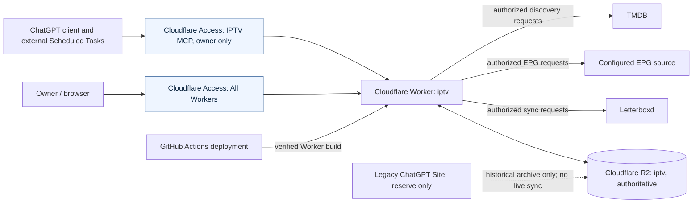

# System context

**Scope:** the deployed IPTV Watchlist system and external actors. This is a context diagram, not a deployment authorization. Verified against the [deployment runbook](../runbooks/deployment.md), [Worker/R2 decision](../adr/0002-cloudflare-worker-r2-authority.md) and [MCP contract](../reference/api/mcp.md).

## Reading this diagram

All browser and MCP HTTP routes use **one Worker**, but the exact `/mcp` path has its own Access application and in-Worker JWT verification. The normal site remains covered by `All Workers`. External Tasks are not Worker cron triggers; invocation and authorization are separate from deploying code. Source reads happen when an approved sync or discovery operation invokes the corresponding path, not on deployment.

The dotted legacy line signifies *historical transfer provenance*, **not** an active data replication process or an operational path. The historical Site remains a separate reserve and must not be used as a writer. R2 is authoritative; prospective D1 adapters do not participate in this production context.

See [MCP security ADR](../adr/0004-mcp-access-boundary.md), [external tasks ADR](../adr/0005-external-chatgpt-tasks.md) and [migration boundary](../adr/0017-staged-d1-migration.md).
