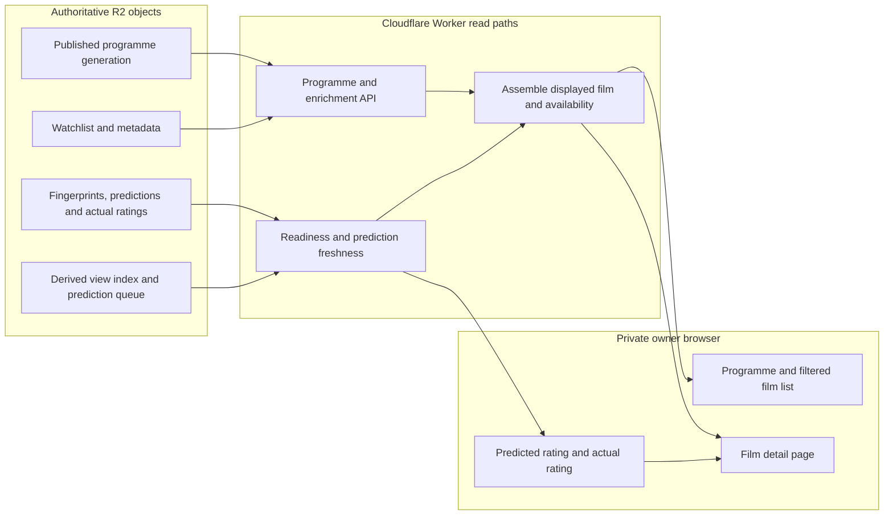

# UI and read-model projections

This diagram describes **current R2-backed projections**, not a new canonical Film database. The browser reads views assembled by the Worker from published programme data and enrichment records. Sources: [Film/Person read contract](../reference/domain/film-person.md), [enrichment API](../reference/api/enrichment.md), [prediction diagnostics](../reference/api/prediction-diagnostics.md), and [fingerprint/prediction ADR](../adr/0014-fingerprint-prediction-lifecycle.md).

The film detail page also ranks a short list of similar films from the programme films already loaded and from the catalog answer the Finds section cached. Watchlist films come first, up to four when the catalog also has a candidate, and catalog films fill the remaining slots to eight; a source with no candidate may use all eight. A displayed reason signature may appear at most twice across that slate. A catalog candidate is ranked only after its own prediction passes the Finds floor: a fresh rating of at least 4.0, a chance of 4+ of at least 0.70, and a confidence that is known and not low. A shared mechanic, credit or execution value does not waive that floor, and the list is not padded when fewer catalog films qualify. A watchlist film with a stored rating and a substantive overlap is not held to that floor. An unused generic execution label does not replace a shared mechanic, person or plot engine that is still under the signature cap. The film page itself is at most 1280px wide. Synopsis, credits, history, comparison and availability stay in a 760px column; the similar-films grid uses the full page width, so a desktop viewport shows more than one card across, and below 760px the grid is one column. Cards follow the Finds card: a poster already on the loaded film, or the Finds placeholder when it has none, with the corner rating and forecast when those numbers are already loaded and fresh. A watchlist card keeps the neutral surface and a catalog card uses the Finds green surface. That list adds no reader and no arrow: a generation mismatch drops the catalog half, and the page does not request the catalog route itself. `watched: true` on the enrichment view, or a stored actual rating, marks a substantive match «Пересмотр» and keeps that film out of a prediction-only suggestion. An unknown `watched` value stays a watchlist film. The page also drops a catalog candidate when that already-loaded view confirms the same film is watched or rated under its own id or a trusted alias. The catalog route remains the eligibility authority.

The currently published programme generation determines which shows are available. A show is not a permanent Film property. The derived view index and prediction queue speed up views and work selection; neither owns Film identity or replaces stored fingerprints, predictions or actual ratings. When the prediction marker is `d1` on schema version 7 or newer, a view-index read replaces the prediction, fingerprint, impact and mood fields from D1 for films already in that index. The caller passes the mood function, and `GET /api/enrichment/view` recomputes the mood from the overlaid fingerprint. A film with no row does not keep those fields from the object. It does not add a film that was not in the index. `watched` and `actualRating` stay on the entry. Migration `0007` is not applied, so that replacement is not live ([ADR 0078](../adr/0078-d1-authoritative-prediction-domain.md)). Prediction freshness depends on fingerprint and taste-profile identity, not on a broadcast slot. Reviewed localization takes precedence over provisional titles, subject to the active read path.

**Owner admin read path:** the `/admin` page is one more browser reader of the published programme generation, through the Worker route `GET /api/admin/*` and the same Access application as the rest of the site. The Worker reads the generation pointer, that generation's programme object and the two localization dictionaries, projects Film and Person records in memory with the pure domain views and pages them with the query library; every answer is pinned to the version tuple of those objects, and a changed dictionary or generation refuses the old pin instead of mixing snapshots. The catalogue reads no enrichment object, lease or ledger. Those catalogue reads write nothing. The five admin sections share a left column of the same width as the programme filters, listing Каталог, Здоровье данных, Архив Letterboxd, Лимб and Постеры. On a narrow screen that column stacks above the page. It does not replace the catalogue queues or the limbo filters. The film card and the person card each have a confirmed POST, listed below. The health view at `/admin/health`, the same document as `/admin`, adds one more read-only route that, beside the same pinned snapshot, reads the view index, the taste profile, the prediction queue, the raw resolver continuation record and the generation's catalog copy, each a single object, and evaluates them in the Worker with the pure data health model; sources it cannot read in a bounded way (the resolution ledger, the Letterboxd import receipts) are reported as unknown, never as healthy. The page leads with a status banner and three KPI cards (critical groups, warning groups, and sources that were not read), then a selectable inbox beside one panel labelled «Выбранная проблема», whose heading is the selected group's name. Routine waiting is a separate compact list, and on a narrow viewport that panel sits under the selected row of either list. Subsystem cards and sources sit in a closed disclosure. The lead counts groups that need a look, or says there is no urgent step when the groups are only routine waiting and unverified sources; a subsystem `attention` is not relabelled. A critical or warning group stays above routine waiting. Choosing a row only repaints the answer already on screen. Each issue names what happened, how many are affected and the kind of next step: waiting, a manual look, a link to a page that has its own confirmed workflow, a read-only list, a pipeline step with no page, or unknown evidence. A link only navigates, and the page says so once. An unsupplied source, and an unknown poster backlog, do not display an affected count of zero. The health answer has no film titles, so several films in one group are numbered links; stored ids, codes and thresholds stay in a closed disclosure. An empty issue list is not a success when a subsystem is unknown or the declared film coverage is partial. The limbo inventory route `GET /api/admin/limbo` reads the same pinned snapshot plus two of those single objects, the prediction queue and the view index, adds both versions to its pin and lists the films that are not progressing with the cause each waits on; it reads no per-film enrichment object and no body of the resolution map or the discovery ledger. It also lists unresolved discovery observations from the published generation's observation index: the manifest and the shards that hold records, with the decision map and the ledger compared by etag only. When that index is fresh or stale and holds records, the same request reads once the resolver continuation, the discovery status and the resolver lease — the objects one observation-recovery read already opens — and asks whether the published-EPG authority is known. Those reads do not write. An absent object is a fact and the gates run. An unreadable continuation, status, lease or published-EPG authority is not a completed check (`checked` false, action counts null) and does not fail the inventory. Mode `d1` is a known refusal of an otherwise eligible reconsider (`unknown_authority`). Their etag tokens join the pin only on that request. Without a readable index, or when the index holds no records, observations are reported as unavailable or empty and no coordination object is read. Each item carries `ownerAction`. A film is never an action on this page. An observation is an action now only when the existing reconsider gate or the existing identity offer is available; a stale index, an ordinary wait and an unknown gate are not. The limb page opens on that action-now queue. The verdict is above the filters. A stale list pin is reread once without the pin; the write confirmation is not. The same answer carries one signature per canonical film already in the inventory. The page offers a refresh when that displayed read is at least 60 minutes old. A successful read that finds 50 of those films differ says the list was updated and does not ask for another refresh. An etag change with the same signatures does not. A failed retry clears the selected detail and does not keep the previous action count. Returning to the tab paints the hour line and does not read. «Все состояния» keeps the four display groups — a decision is required, an ordinary step is not scheduled and no owner write is offered, the ordinary pipeline is expected to move them, or the state could not be checked — and a missing, stale or partial observation index is not presented as an empty limb. The owner expressly accepted the fourth display group on 2026-11-03, superseding the original three-group wireframe. Coverage above the queue is one line. The counts, the search field and the cause buttons sit in closed disclosures after the queue. Cause indicators are compact buttons: a pressed cause is included, an unpressed cause is excluded, and releasing every button lists nothing. The number on a button in the action queue is confirmed actions; the inventory count is labelled separately. «Обновить» rereads the snapshot and does not start a pipeline. «Найти запись» matches titles of rows already shown and does not query the inventory, because the route has no text-search parameter. Escape in that field clears only the local title. «Сбросить фильтры» clears it with the server filter and reads again only when a server filter was set. The queue is the working surface under the verdict. The selected record is the column beside it on a wide screen and the block under the row on a narrow one; the block names the record by title, year and kind, the wide column takes that title as its accessible name, and a jump on the selected row moves focus to the heading while arrow keys stay on the queue. The action sentence follows the control on the row and does not treat a data-health eligibility flag as a confirmed write. Filters, the snapshot and the pipeline thresholds sit in closed disclosures after that queue. The exact-key search for one verified match sits after those disclosures, closed. From an item on `/admin/limb` the page can open the prediction recovery read `GET /api/admin/prediction-recovery`, which for one film reads the objects the prediction diagnostics read (queue, profile, view index, generation programme and catalog, that film's fingerprint and prediction) plus the runner lease and the latest run, through a bucket wrapper that exposes only `get`, and explains the film's state with a pure assessment; it offers no action and there is no targeted prediction writer. The poster coverage route `GET /api/admin/posters` reads the generation pointer, the two catalog copies and the remembered-answer index `epg/catalog-poster-negatives.json`, counts them with the maintenance route's rule and shows the next bounded batch of the actionable queue. An absent index is empty; an unreadable one makes the coverage unknown. From an observation item the `/admin/limb` page opens `GET /api/admin/discovery-recovery`, which explains one observation from its index shard and the resolver's small coordination objects through a `get`/`head`-only wrapper. All six are projections of published R2 objects, not a canonical Film database, and none executes an action. Four admin pages can cause a write, each only after the owner confirms one exact scope:

- `/admin` sends two confirmed same-origin POSTs. Each card has **Добавить вариант** and **Сделать предпочтительным**. The film command writes one `films` entry of `admin/owner-reviews.json` and copies `people`. The person command writes the `people` entries of one command and copies `films`. «Добавить вариант» stores an alias and leaves the preferred value. «Сделать предпочтительным» stores a new preferred value ([film title review](../reference/domain/film-title-review.md), [owner name confirmation](film-person-lifecycle.md#owner-name-confirmation), [ADR 0072](../adr/0072-owner-reviewed-localization-overlay.md)). Search is first. Quality queues are a closed disclosure, and a zero count is omitted unless that queue is already selected. On a wide screen the results sit beside the selected card. At 800px and below the open card replaces the result list until «К результатам». A change of search or quality queue clears the selected record immediately, including on a narrow screen, so the result list is visible again. The confirmed sentence appears only after the card is reread and proves the command. The health view of the same page stays read-only.

- `/admin/posters` calls the existing owner-only maintenance route `POST /api/enrichment/catalog/posters` for one bounded run, or for one explicit recheck of a remembered answer. The page leads with four counts from the read-only coverage: without a poster, actionable now, held (a 90-day no-poster answer or an identity mismatch), and without a verified TMDB id. An unknown figure stays «неизвестно» and is not shown as zero. Batch size, call budget and start stay in a closed «Дополнительные настройки», with defaults of one call of ten records. «Перечитать» only repeats the GET. A failed repeat labels the previous figures as not current and does not offer a run. The run is still preview, exact confirmation, progress with «Остановить после текущего пакета», then a receipt that names each outcome. History is a later card, «История этого браузера», and is not a server audit. That route's lease, generation and compare-and-swap guards are the [poster hydration path](discovery-and-resolution.md); the same call records a terminal TMDB refusal in the remembered-answer index under those guards.
- `/admin/limb` sends the guarded `discovery_reconsider` action: two same-origin POSTs, a server-issued confirmation and then the execution, which may change one decision of one observation under the resolver lease ([discovery recovery](discovery-and-resolution.md)).
- `/admin/letterboxd` can send two further same-origin POSTs after a preview. The page walks five steps one at a time: the ZIP, freshness and completeness, the exact difference, one confirmed batch, then the receipt. Only the current step is mounted. Back and Continue do not send a request, and the receipt step appears only after a write or rollback attempt. The difference leads with additions, changes and skips. An incomplete comparison is not called a full check, and the archive hash, file hashes, programme run id, chunk id, plan hash and scope fingerprint stay in a closed disclosure. Confirm stores the issued confirmation only. A separate execute writes one chunk of at most 50 compared films through the baseline commit. A `partial` or `unknown` receipt is not success. A lost response is `unknown` and is not described as a write that never started. «Прервать ожидание» stays outside the file form while a confirm, commit or rollback is in flight. Cancelling that wait does not undo the Worker, and the same confirmation stays available for a manual retry. Another file or declared time marks that preview stale and disables write controls that have not already been sent; an unresolved command stays until the owner forgets it in the tab, which is not a rollback. A lost confirm or rollback confirmation offers that same forget control. HTTP 409 `in_progress` stays replayable with the issued confirmation. A refused rollback does not replace the apply receipt. `unknown` can be sent again only as that same confirmation, using the file from the check that issued it. A rollback is the same two-step shape and keeps a later observation ([confirmed apply](letterboxd-ingestion.md#confirmed-archive-apply-proposed), [ADR 0068](../adr/0068-letterboxd-archive-confirmed-apply.md)). The preview request itself still writes nothing.

The Letterboxd archive page `/admin/letterboxd` sends the owner's export ZIP in one `POST /api/admin/letterboxd-archive/preview`. The Worker reads it in memory, compares it with single named R2 objects through a get-only wrapper and answers with a bounded proposal. That request stores nothing and applies nothing ([archive preview path](letterboxd-ingestion.md#owner-archive-preview-no-write), [ADR 0066](../adr/0066-ephemeral-letterboxd-archive-preview.md)). The archive itself is still stored nowhere. The confirm and execute clicks, when the owner makes them, each upload the ZIP again. A later check asks for the same file again, and it does not start while a confirmation or a write in this tab is still `unknown`.

Contracts: [admin read model](../reference/domain/admin-read-contract.md), [route](../reference/api/admin.md), [data health model](../reference/domain/data-health.md).

The programme page, the film screen and the expanded events screen share one status footer in the document flow. The same footer is mounted on the five admin sections (`/admin`, `/admin/health`, `/admin/letterboxd`, `/admin/limbo` and `/admin/posters`) and is filled only by `GET /api/enrichment/footer/status`. The block of `public/app.js` and `public/status-footer.js` that reads and paints it is kept byte-identical (a test compares the two copies, and the two copies of the markup), so the pages cannot drift apart. «Показать детали» stays the disclosure; «Админка» stays the link after it.

**Compact footer.** The footer answers four questions instead of listing thirty-three technical fields: what is in my collection, how useful are the recommendations, how fresh is the programme, and does the automation work. It shows five indicators — **Коллекция** (unique films), **Прогнозы** (current predictions over the local database), **Новые 4.0+** (new films, with the 4.5+ share), **EPG** (the last confirmed update) and **Автоматизация** (an aggregate of the five integrations) — and, behind «Показать детали», exactly four groups of eighteen rows:

| Group | Rows | Meaning |
| --- | --- | --- |
| Моя коллекция | всего фильмов, просмотрено, оценено, в watchlist | Counters overlap and are not a partition. One film is one verified canonical TMDB identity; an id that no stored record links to a TMDB id is its own film and is never merged with a catalog film. Watched means a confirmed watched fact, rated means a stored rating (the view index after the compiled ratings seed); «not on the watchlist» and «not in the Diary» are never taken as watched |
| Рекомендации | прогнозы по всей базе, прогнозы в окне просмотра, новые 4.5 и выше, новые от 4.0 до 4.4, модель вкуса | Current means current for the present taste profile and fingerprint. Coverage uses the canonical identities, so aliases and duplicate catalog records count once |
| Кинопрограмма | обновление EPG, известные передачи, распознано фильмов, ждут распознавания | The update time is the last confirmed EPG success, not the time the page opened. Recognised films and pending candidates are different units (a candidate is an EPG transmission not yet identified as a film) and are never summed or divided |
| Автоматизация | Watchlist, оценки, загрузка EPG, распознавание, прогнозы | Short state with the last confirmed success; «нет данных» is not a failure and a retry wait is not an outage. Links: «События» (`/events`) and «Диагностика» (`/admin/health`) |

**New films.** A «new» film is a verified catalog movie outside the watchlist that the owner has neither watched nor rated, with a prediction that is current for the present profile and fingerprint and passes the same floor as «Находки» (rating 4.0 or more, chance of 4+ at least 70%, effective confidence not low). The two ranges do not overlap: 4.0 to 4.4 and 4.5 and above. The show window is not applied (it counts the collection, not the airing now), and a film with two catalog records counts once at its best current prediction. The exact formulas and the sources are in the [footer API reference](../reference/api/enrichment.md#compact-footer-read-model).

**Unknown is not zero.** A count that cannot be read is «нет данных», never 0 and never 100%; an empty collection is a known 0. When the server could not read a source (it names it in the optional `degraded` list, for example the Discovery ledger while its transfer is `loading`), everything that needs it arrives as `null` and is shown the same way; the footer itself keeps answering instead of failing as a whole. A failed read before any success says «статус недоступен» for the five indicators. After a successful read, a later failed refresh keeps the last confirmed counts on screen as a labelled stale snapshot («Не удалось обновить. Показаны данные от …») and shows the health indicators (EPG, automation and the five integration rows) as «статус недоступен», so an old «всё работает» is never presented as current; a recovered read clears the note.

**Removed from the user footer, kept in the API and in diagnostics:** the cold queue, cache outside the window (both duplicates), films waiting for a background prediction outside the window, retry deferrals, the current and next batch, the historical journal, channels, checked transmissions, films without metadata, titles awaiting review, the separate «Последний запуск» block and the separate «Модель вкуса» block. All of these are still fields of `GET /api/enrichment/footer/status`, `GET /api/enrichment/status` and the Admin Health diagnostics; the footer links to `/admin/health` and `/events` for them.

On an admin page the events link opens `/events`. On the programme page and the film screen the footer events link is a real `/events` link too: a plain click opens the in-page events screen (leaving the film screen first, so Back returns to the film), while a new-tab, copy-link or modified click uses native navigation to `/events`.

**Returning to the programme.** The film screen, the events screen and every admin page show one link, «На главную», first in the content container under the header (`public/return-home.js`; the same label, style and place everywhere). The programme's own path, query and hash travel in the URL of each page opened from it as the single `return` parameter, encoded once: on the film and events URLs, on the footer events and admin links, on the admin section links and in the admin catalogue and limbo URLs. Nested navigation (film to events to film, between admin sections) and a reload keep it because it is in the URL, not in script state or storage. Only a canonical internal home target is accepted: pathname exactly `/`, no scheme, host, `//`, backslash or control character. A missing or rejected value means `/`, the canonical home, so a bookmark or a deep link never restores an old session and there is no open redirect. A screen opened straight from the programme page returns by Back (scroll kept, no extra history entry); in every other case the link is a plain navigation to the target. A film card link takes the programme's current state as its target before a new-tab open or a copy.

**One frame for the programme, the film page and the events screen.** These three routes share the programme's two-column workspace, with the same sidebar width, left offset and main column, so moving between them changes the content and not the layout (on narrow screens the sidebar stacks above the main column, as on the programme). On the film page the sidebar stays whole, with every filter and the compact event feed, and the film replaces only the programme column; a filter changed there (a person, a facet, a channel) is applied at once and is part of the return target in the film URL, so «На главную» returns to the set actually chosen. On the events screen the sidebar shows only «Тип событий» and the full feed is in the main column. The feed is one node that moves between the sidebar and the main column, so it is never rendered twice and there is one fetch. The type choice and the guarded automatic search it starts are described in the [events reference](../reference/domain/events.md#type-filter-on-the-events-screen).

**Default sort and Finds links (AIR-382).** The programme list opens sorted by «Для меня» (`personal`) when the URL has no `sort`, after «Сбросить» and after the search box is cleared; the select's default option is the same. A chosen `title`, `personal` or `expiring` is kept and written to the URL, an explicit `personal` included, with or without a search query, so a reload, history entry or shared link keeps the choice (the implicit default writes nothing); `relevance` is automatic only while a query exists and no sort was chosen, and a `?sort=relevance` link without a query loads as `personal`. The retired `time` sort has no option and no code: an old `?sort=time` link, like any unknown value, falls back to the default and the parameter is dropped at the next URL normalization. The title of a Finds card and of a catalog-only similar film is **not** a TMDB link: since AIR-387 it opens the internal film page `/film/tmdb_<n>` when the film's identity is verified (see [One permanent film URL](#one-permanent-film-url-air-387)) and is plain text otherwise. The Letterboxd icon is always the shared `letterboxdLink(film)`, in the Finds card title and in every similar-film card title (watchlist and catalog-only rows alike; the rows carry the film object unchanged, so `url` and `letterboxdUrl` reach the helper). The target comes from one pure resolver, `letterboxdTarget(film,{catalog})`, in this order: (1) a validated canonical Letterboxd film URL, which always wins: `letterboxdUrl`, and for a watchlist/local film also its `url` (for a catalog-only film `url` is its TMDB page and is ignored here); (2) only for a catalog-only film (the Finds card and catalog rows of the similar list) whose `canonicalIdentity` is exactly `tmdb:<n>` and agrees with a positive-integer `tmdbId`, Letterboxd's documented redirect `https://letterboxd.com/tmdb/<n>` (AIR-384), labelled «Открыть в Letterboxd по TMDB id»; (3) otherwise no icon. The redirect is a navigation aid, not a Letterboxd id, slug or provenance: it is derived at render time, never stored, never put into `letterboxdUrl` or an identity record, and never fetched or verified, so the page does not claim the film exists on Letterboxd. Watchlist/local rows never get the fallback; TV identities, mismatched or malformed ids and title/year-only matches get no icon; a slug is never built from a title ([catalog reference](../reference/api/catalog.md#letterboxdurl)). Clicking the icon opens a new tab (`rel="noopener noreferrer"`); a watchlist title in the similar list still opens its internal film page. No storage, authority or identity behaviour changes.

#### One permanent film URL (AIR-387)

`/film/tmdb_<n>` is the permanent URL of a TMDB movie, for a watchlist film and for a catalog-only film alike; `/film/<letterboxd id>` stays a working alias that opens the same page. The page is the existing film screen (sidebar, «На главную» with the return target, history, similar films); there is no second UI.

- **Which watchlist films earn the permalink.** Only a film whose record proves a movie: `tmdbLink.status` is `resolved`, its link type is `movie` and its id equals `tmdbId` (positive integer, at most 12 digits). A TV link, an unresolved or contradictory link, a record written before the field existed, a number held by two loaded films, or a mismatch keeps the Letterboxd id, which always works. Nothing is guessed from a title or a year; no storage id, rating, fact or prediction key changes. Cards link to the permalink; opening an alias of a proven film rewrites the visible URL in place (`replaceState`, same entry, `return` kept), so Back, Forward, reload and deep links behave as before.
- **What a TMDB route resolves to, in this order:** a loaded programme film (by its own id, or by the permalink it proves); a catalog film the Finds already hold for the loaded generation; otherwise one permanent read, `GET /api/catalog/film/<tmdbId>` ([reference](../reference/api/catalog.md#permanent-catalog-film-api-catalog-film-tmdbid)). `GET /api/catalog/available` is not the lookup: it is limited to the hot window and to eligibility. Two loaded films proving one number show a conflict, never a guess. Catalog to watchlist keeps the same permalink; the page then shows the watchlist film.
- **States.** `loading` is shown until the programme could still resolve the alias (never «не найден» before both sources answered); `absent`, `retired`, `conflict`, `unavailable` and `error` each have their own message and no film is invented. A found film is cached for the session; absent, retired and conflict are settled; a transient failure is asked again after 15 seconds on a later render. A cached film on another generation than the loaded programme is refreshed once per generation in the background while the old one stays on screen; a failed refresh keeps it, and an answer pinned to another run is shown and not asked for again until the programme moves.
- **A catalog-only page** shows the shared blocks (title, original, year, runtime, genres, poster, validated Letterboxd link by the AIR-384 rule, current prediction and rationale, characteristics, people, availability, history, similar films). Zero shows is the honest placeholder, a stale or absent prediction is «Прогноз ещё не готов», and there is no Letterboxd rating card (the film is outside the watchlist). It hides «Начал просмотр», the comparison block and the synopsis; a watchlist film keeps them. History reads the existing `GET /api/enrichment/history` with the film's own id.
- **Similar films** rank from the catalog film's own prediction and fingerprint (`similarCatalogView`); the source film is excluded by its verified identity from both lists; no further request is made.
- **Boundaries.** Presentation and one read-only GET. No D1/R2 write, no authority, identity or admission change, no provider call. A retired or removed catalog record is reported as such; the page never claims to restore it.

**Important side-effect boundary:** do not assume all HTTP GET requests are pure reads. Some existing view/event handlers can initialize or recover persisted state; consult the [deployment runbook](../runbooks/deployment.md) and [GET side-effect tests](../../tests/get-side-effects.mjs) before operational probing.

**Not depicted as production:** D1 canonical repositories and a future read cutover. The [D1 migration ADR](../adr/0017-staged-d1-migration.md) requires separately approved steps before replacing R2 readers.
