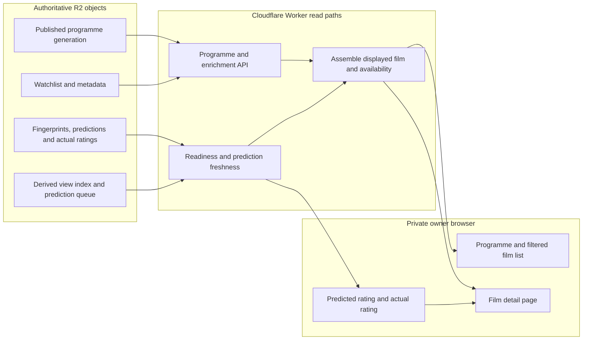

# UI and read-model projections

This diagram describes **current R2-backed projections**, not a new canonical Film database. The browser reads views assembled by the Worker from published programme data and enrichment records. Sources: [Film/Person read contract](../reference/domain/film-person.md), [enrichment API](../reference/api/enrichment.md), [prediction diagnostics](../reference/api/prediction-diagnostics.md), and [fingerprint/prediction ADR](../adr/0014-fingerprint-prediction-lifecycle.md).

The film detail page also ranks a short list of similar films from the programme films already loaded and from the catalog answer the Finds section cached. That list adds no reader and no arrow: a generation mismatch drops the catalog half, and the page does not request the catalog route itself. `watched: true` on the enrichment view, or a stored actual rating, marks a substantive match «Пересмотр» and keeps that film out of a prediction-only suggestion. An unknown `watched` value stays a watchlist film. The page also drops a catalog candidate when that already-loaded view confirms the same film is watched or rated under its own id or a trusted alias. The catalog route remains the eligibility authority.

The currently published programme generation determines which shows are available. A show is not a permanent Film property. The derived view index and prediction queue speed up views and work selection; neither owns Film identity or replaces stored fingerprints, predictions or actual ratings. Prediction freshness depends on fingerprint and taste-profile identity, not on a broadcast slot. Reviewed localization takes precedence over provisional titles, subject to the active read path.

**Owner admin read path:** the `/admin` page is one more browser reader of the published programme generation, through the Worker route `GET /api/admin/*` and the same Access application as the rest of the site. The Worker reads the generation pointer, that generation's programme object and the two localization dictionaries, projects Film and Person records in memory with the pure domain views and pages them with the query library; every answer is pinned to the version tuple of those objects, and a changed dictionary or generation refuses the old pin instead of mixing snapshots. The catalogue reads no enrichment object, lease or ledger. Those catalogue reads write nothing. The film card and the person card each have a confirmed POST, listed below. The page's health view adds one more read-only route that, beside the same pinned snapshot, reads the view index, the taste profile, the prediction queue, the raw resolver continuation record and the generation's catalog copy, each a single object, and evaluates them in the Worker with the pure data health model; sources it cannot read in a bounded way (the resolution ledger, the Letterboxd import receipts) are reported as unknown, never as healthy. The limbo inventory route `GET /api/admin/limbo` reads the same pinned snapshot plus two of those single objects, the prediction queue and the view index, adds both versions to its pin and lists the films that are not progressing with the cause each waits on; it reads no per-film enrichment object, ledger, lease or continuation. It also lists unresolved discovery observations from the published generation's observation index: the manifest and the shards that hold records, with the decision map and the ledger compared by etag only. Without a readable index, observations are reported as unavailable. From a limbo item the page can open the prediction recovery read `GET /api/admin/prediction-recovery`, which for one film reads the objects the prediction diagnostics read (queue, profile, view index, generation programme and catalog, that film's fingerprint and prediction) plus the runner lease and the latest run, through a bucket wrapper that exposes only `get`, and explains the film's state with a pure assessment; it offers no action and there is no targeted prediction writer. The poster coverage route `GET /api/admin/posters` reads the generation pointer, the two catalog copies and the remembered-answer index `epg/catalog-poster-negatives.json`, counts them with the maintenance route's rule and shows the next bounded batch of the actionable queue. An absent index is empty; an unreadable one makes the coverage unknown. From an observation item the limbo page opens `GET /api/admin/discovery-recovery`, which explains one observation from its index shard and the resolver's small coordination objects through a `get`/`head`-only wrapper. All six are projections of published R2 objects, not a canonical Film database, and none executes an action. Four admin pages can cause a write, each only after the owner confirms one exact scope:

- `/admin` sends two confirmed same-origin POSTs. Both buttons are **Сохранить вариант**. The film command writes one `films` entry of `admin/owner-reviews.json` and copies `people`. The person command writes the `people` entries of one command and copies `films`. On each card the checkbox «Использовать как предпочтительное» chooses an added alias or a new preferred value ([film title review](../reference/domain/film-title-review.md), [owner name confirmation](film-person-lifecycle.md#owner-name-confirmation), [ADR 0072](../adr/0072-owner-reviewed-localization-overlay.md)). The health view of the same page stays read-only.

- `/admin/posters` calls the existing owner-only maintenance route `POST /api/enrichment/catalog/posters` for one bounded run, or for one explicit recheck of a remembered answer. That route's lease, generation and compare-and-swap guards are the [poster hydration path](discovery-and-resolution.md); the same call records a terminal TMDB refusal in the remembered-answer index under those guards.
- `/admin/limbo` sends the guarded `discovery_reconsider` action: two same-origin POSTs, a server-issued confirmation and then the execution, which may change one decision of one observation under the resolver lease ([discovery recovery](discovery-and-resolution.md)).
- `/admin/letterboxd` can send two further same-origin POSTs after a preview. Confirm stores the issued confirmation only. A separate execute writes one chunk of at most 50 compared films through the baseline commit. A rollback is the same two-step shape and keeps a later observation ([confirmed apply](letterboxd-ingestion.md#confirmed-archive-apply-proposed), [ADR 0068](../adr/0068-letterboxd-archive-confirmed-apply.md)). The preview request itself still writes nothing.

The Letterboxd archive page `/admin/letterboxd` sends the owner's export ZIP in one `POST /api/admin/letterboxd-archive/preview`. The Worker reads it in memory, compares it with single named R2 objects through a get-only wrapper and answers with a bounded proposal. That request stores nothing and applies nothing ([archive preview path](letterboxd-ingestion.md#owner-archive-preview-no-write), [ADR 0066](../adr/0066-ephemeral-letterboxd-archive-preview.md)). The archive itself is still stored nowhere. The confirm and execute clicks, when the owner makes them, each upload the ZIP again.

Contracts: [admin read model](../reference/domain/admin-read-contract.md), [route](../reference/api/admin.md), [data health model](../reference/domain/data-health.md).

**Important side-effect boundary:** do not assume all HTTP GET requests are pure reads. Some existing view/event handlers can initialize or recover persisted state; consult the [deployment runbook](../runbooks/deployment.md) and [GET side-effect tests](../../tests/get-side-effects.mjs) before operational probing.

**Not depicted as production:** D1 canonical repositories and a future read cutover. The [D1 migration ADR](../adr/0017-staged-d1-migration.md) requires separately approved steps before replacing R2 readers.
