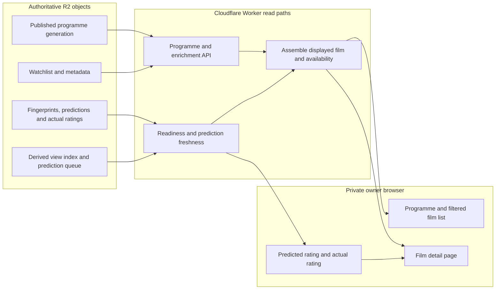

# UI and read-model projections

This diagram describes **current R2-backed projections**, not a new canonical Film database. The browser reads views assembled by the Worker from published programme data and enrichment records. Sources: [Film/Person read contract](../reference/domain/film-person.md), [enrichment API](../reference/api/enrichment.md), [prediction diagnostics](../reference/api/prediction-diagnostics.md), and [fingerprint/prediction ADR](../adr/0014-fingerprint-prediction-lifecycle.md).

The film detail page also ranks a short list of similar films from the programme films already loaded and from the catalog answer the Finds section cached. Watchlist films come first, up to four when the catalog also has a candidate, and catalog films fill the remaining slots to eight; a source with no candidate may use all eight. A displayed reason signature may appear at most twice across that slate. A catalog candidate is ranked only after its own prediction passes the Finds floor: a fresh rating of at least 4.0, a chance of 4+ of at least 0.70, and a confidence that is known and not low. A shared mechanic, credit or execution value does not waive that floor, and the list is not padded when fewer catalog films qualify. A watchlist film with a stored rating and a substantive overlap is not held to that floor. An unused generic execution label does not replace a shared mechanic, person or plot engine that is still under the signature cap. The film page itself is at most 1280px wide. Synopsis, credits, history, comparison and availability stay in a 760px column; the similar-films grid uses the full page width, so a desktop viewport shows more than one card across, and below 760px the grid is one column. Cards follow the Finds card: a poster already on the loaded film, or the Finds placeholder when it has none, with the corner rating and forecast when those numbers are already loaded and fresh. A watchlist card keeps the neutral surface and a catalog card uses the Finds green surface. That list adds no reader and no arrow: a generation mismatch drops the catalog half, and the page does not request the catalog route itself. `watched: true` on the enrichment view, or a stored actual rating, marks a substantive match «Пересмотр» and keeps that film out of a prediction-only suggestion. An unknown `watched` value stays a watchlist film. The page also drops a catalog candidate when that already-loaded view confirms the same film is watched or rated under its own id or a trusted alias. The catalog route remains the eligibility authority.

The currently published programme generation determines which shows are available. A show is not a permanent Film property. The derived view index and prediction queue speed up views and work selection; neither owns Film identity or replaces stored fingerprints, predictions or actual ratings. When the prediction marker is `d1` on schema version 7 or newer, a view-index read replaces the prediction, fingerprint, impact and mood fields from D1 for films already in that index. The caller passes the mood function, and `GET /api/enrichment/view` recomputes the mood from the overlaid fingerprint. A film with no row does not keep those fields from the object. It does not add a film that was not in the index. `watched` and `actualRating` stay on the entry. Migration `0007` is not applied, so that replacement is not live ([ADR 0078](../adr/0078-d1-authoritative-prediction-domain.md)). Prediction freshness depends on fingerprint and taste-profile identity, not on a broadcast slot. Reviewed localization takes precedence over provisional titles, subject to the active read path.

**Owner admin read path:** the `/admin` page is one more browser reader of the published programme generation, through the Worker route `GET /api/admin/*` and the same Access application as the rest of the site. The Worker reads the generation pointer, that generation's programme object and the two localization dictionaries, projects Film and Person records in memory with the pure domain views and pages them with the query library; every answer is pinned to the version tuple of those objects, and a changed dictionary or generation refuses the old pin instead of mixing snapshots. The catalogue reads no enrichment object, lease or ledger. Those catalogue reads write nothing. The five admin sections share a left column of the same width as the programme filters, listing Каталог, Здоровье данных, Архив Letterboxd, Лимб and Постеры. On a narrow screen that column stacks above the page. It does not replace the catalogue queues or the limbo filters. The film card and the person card each have a confirmed POST, listed below. The health view at `/admin/health`, the same document as `/admin`, adds one more read-only route that, beside the same pinned snapshot, reads the view index, the taste profile, the prediction queue, the raw resolver continuation record and the generation's catalog copy, each a single object, and evaluates them in the Worker with the pure data health model; sources it cannot read in a bounded way (the resolution ledger, the Letterboxd import receipts) are reported as unknown, never as healthy. The page leads with a status banner and three KPI cards (critical groups, warning groups, and sources that were not read), then a selectable inbox beside one panel labelled «Выбранная проблема», whose heading is the selected group's name. Routine waiting is a separate compact list, and on a narrow viewport that panel sits under the selected row of either list. Subsystem cards and sources sit in a closed disclosure. The lead counts groups that need a look, or says there is no urgent step when the groups are only routine waiting and unverified sources; a subsystem `attention` is not relabelled. A critical or warning group stays above routine waiting. Choosing a row only repaints the answer already on screen. Each issue names what happened, how many are affected and the kind of next step: waiting, a manual look, a link to a page that has its own confirmed workflow, a read-only list, a pipeline step with no page, or unknown evidence. A link only navigates, and the page says so once. An unsupplied source, and an unknown poster backlog, do not display an affected count of zero. The health answer has no film titles, so several films in one group are numbered links; stored ids, codes and thresholds stay in a closed disclosure. An empty issue list is not a success when a subsystem is unknown or the declared film coverage is partial. The limbo inventory route `GET /api/admin/limbo` reads the same pinned snapshot plus two of those single objects, the prediction queue and the view index, adds both versions to its pin and lists the films that are not progressing with the cause each waits on; it reads no per-film enrichment object and no body of the resolution map or the discovery ledger. It also lists unresolved discovery observations from the published generation's observation index: the manifest and the shards that hold records, with the decision map and the ledger compared by etag only. When that index is fresh or stale and holds records, the same request reads once the resolver continuation, the discovery status and the resolver lease — the objects one observation-recovery read already opens — and asks whether the published-EPG authority is known. Those reads do not write. An absent object is a fact and the gates run. An unreadable continuation, status, lease or published-EPG authority is not a completed check (`checked` false, action counts null) and does not fail the inventory. Mode `d1` is a known refusal of an otherwise eligible reconsider (`unknown_authority`). Their etag tokens join the pin only on that request. Without a readable index, or when the index holds no records, observations are reported as unavailable or empty and no coordination object is read. Each item carries `ownerAction`. A film is never an action on this page. An observation is an action now only when the existing reconsider gate or the existing identity offer is available; a stale index, an ordinary wait and an unknown gate are not. The limb page opens on that action-now queue. The verdict is above the filters. A stale list pin is reread once without the pin; the write confirmation is not. The same answer carries one signature per canonical film already in the inventory. The page offers a refresh when that displayed read is at least 60 minutes old. A successful read that finds 50 of those films differ says the list was updated and does not ask for another refresh. An etag change with the same signatures does not. A failed retry clears the selected detail and does not keep the previous action count. Returning to the tab paints the hour line and does not read. «Все состояния» keeps the four display groups — a decision is required, an ordinary step is not scheduled and no owner write is offered, the ordinary pipeline is expected to move them, or the state could not be checked — and a missing, stale or partial observation index is not presented as an empty limb. The owner expressly accepted the fourth display group on 2026-11-03, superseding the original three-group wireframe. Coverage above the queue is one line. The counts, the search field and the cause buttons sit in closed disclosures after the queue. Cause indicators are compact buttons: a pressed cause is included, an unpressed cause is excluded, and releasing every button lists nothing. The number on a button in the action queue is confirmed actions; the inventory count is labelled separately. «Обновить» rereads the snapshot and does not start a pipeline. «Найти запись» matches titles of rows already shown and does not query the inventory, because the route has no text-search parameter. Escape in that field clears only the local title. «Сбросить фильтры» clears it with the server filter and reads again only when a server filter was set. The queue is the working surface under the verdict. The selected record is the column beside it on a wide screen and the block under the row on a narrow one; the block names the record by title, year and kind, the wide column takes that title as its accessible name, and a jump on the selected row moves focus to the heading while arrow keys stay on the queue. The action sentence follows the control on the row and does not treat a data-health eligibility flag as a confirmed write. Filters, the snapshot and the pipeline thresholds sit in closed disclosures after that queue. The exact-key search for one verified match sits after those disclosures, closed. From an item on `/admin/limb` the page can open the prediction recovery read `GET /api/admin/prediction-recovery`, which for one film reads the objects the prediction diagnostics read (queue, profile, view index, generation programme and catalog, that film's fingerprint and prediction) plus the runner lease and the latest run, through a bucket wrapper that exposes only `get`, and explains the film's state with a pure assessment; it offers no action and there is no targeted prediction writer. The poster coverage route `GET /api/admin/posters` reads the generation pointer, the two catalog copies and the remembered-answer index `epg/catalog-poster-negatives.json`, counts them with the maintenance route's rule and shows the next bounded batch of the actionable queue. An absent index is empty; an unreadable one makes the coverage unknown. From an observation item the `/admin/limb` page opens `GET /api/admin/discovery-recovery`, which explains one observation from its index shard and the resolver's small coordination objects through a `get`/`head`-only wrapper. All six are projections of published R2 objects, not a canonical Film database, and none executes an action. Four admin pages can cause a write, each only after the owner confirms one exact scope:

- `/admin` sends two confirmed same-origin POSTs. Both buttons are **Сохранить вариант**. The film command writes one `films` entry of `admin/owner-reviews.json` and copies `people`. The person command writes the `people` entries of one command and copies `films`. On each card the checkbox «Использовать как предпочтительное» chooses an added alias or a new preferred value ([film title review](../reference/domain/film-title-review.md), [owner name confirmation](film-person-lifecycle.md#owner-name-confirmation), [ADR 0072](../adr/0072-owner-reviewed-localization-overlay.md)). The health view of the same page stays read-only.

- `/admin/posters` calls the existing owner-only maintenance route `POST /api/enrichment/catalog/posters` for one bounded run, or for one explicit recheck of a remembered answer. That route's lease, generation and compare-and-swap guards are the [poster hydration path](discovery-and-resolution.md); the same call records a terminal TMDB refusal in the remembered-answer index under those guards.
- `/admin/limb` sends the guarded `discovery_reconsider` action: two same-origin POSTs, a server-issued confirmation and then the execution, which may change one decision of one observation under the resolver lease ([discovery recovery](discovery-and-resolution.md)).
- `/admin/letterboxd` can send two further same-origin POSTs after a preview. Confirm stores the issued confirmation only. A separate execute writes one chunk of at most 50 compared films through the baseline commit. A rollback is the same two-step shape and keeps a later observation ([confirmed apply](letterboxd-ingestion.md#confirmed-archive-apply-proposed), [ADR 0068](../adr/0068-letterboxd-archive-confirmed-apply.md)). The preview request itself still writes nothing.

The Letterboxd archive page `/admin/letterboxd` sends the owner's export ZIP in one `POST /api/admin/letterboxd-archive/preview`. The Worker reads it in memory, compares it with single named R2 objects through a get-only wrapper and answers with a bounded proposal. That request stores nothing and applies nothing ([archive preview path](letterboxd-ingestion.md#owner-archive-preview-no-write), [ADR 0066](../adr/0066-ephemeral-letterboxd-archive-preview.md)). The archive itself is still stored nowhere. The confirm and execute clicks, when the owner makes them, each upload the ZIP again.

Contracts: [admin read model](../reference/domain/admin-read-contract.md), [route](../reference/api/admin.md), [data health model](../reference/domain/data-health.md).

The programme page, the film screen and the expanded events screen share one status footer in the document flow. The same footer is mounted on the five admin sections (`/admin`, `/admin/health`, `/admin/letterboxd`, `/admin/limb` and `/admin/posters`) and is filled only by `GET /api/enrichment/footer/status`. A failed read says the status is unavailable and does not present a healthy state. After a successful read, a later failed refresh replaces that live reading with the same unavailable warning and the time of the last successful read. A coverage numerator or denominator that is missing is «нет данных», with no percentage; a stored zero stays zero. «Показать детали» stays the disclosure; «Админка» stays the link after it. On an admin page the events links open `/events`.

**Important side-effect boundary:** do not assume all HTTP GET requests are pure reads. Some existing view/event handlers can initialize or recover persisted state; consult the [deployment runbook](../runbooks/deployment.md) and [GET side-effect tests](../../tests/get-side-effects.mjs) before operational probing.

**Not depicted as production:** D1 canonical repositories and a future read cutover. The [D1 migration ADR](../adr/0017-staged-d1-migration.md) requires separately approved steps before replacing R2 readers.
