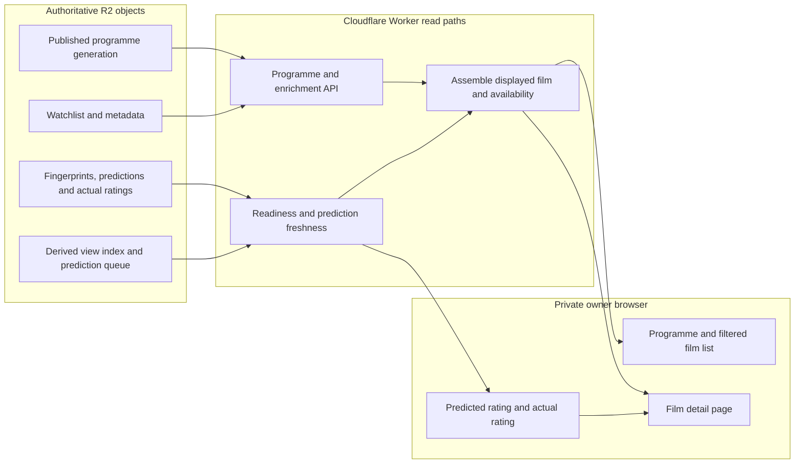

# UI and read-model projections

This diagram describes **current R2-backed projections**, not a new canonical Film database. The browser reads views assembled by the Worker from published programme data and enrichment records. Sources: [Film/Person read contract](../reference/domain/film-person.md), [enrichment API](../reference/api/enrichment.md), [prediction diagnostics](../reference/api/prediction-diagnostics.md), and [fingerprint/prediction ADR](../adr/0014-fingerprint-prediction-lifecycle.md).

The currently published programme generation determines which shows are available. A show is not a permanent Film property. The derived view index and prediction queue speed up views and work selection; neither owns Film identity or replaces stored fingerprints, predictions or actual ratings. Prediction freshness depends on fingerprint and taste-profile identity, not on a broadcast slot. Reviewed localization takes precedence over provisional titles, subject to the active read path.

**Important side-effect boundary:** do not assume all HTTP GET requests are pure reads. Some existing view/event handlers can initialize or recover persisted state; consult the [deployment runbook](../runbooks/deployment.md) and [GET side-effect tests](../../tests/get-side-effects.mjs) before operational probing.

**Not depicted as production:** D1 canonical repositories and a future read cutover. The [D1 migration ADR](../adr/0017-staged-d1-migration.md) requires separately approved steps before replacing R2 readers.
